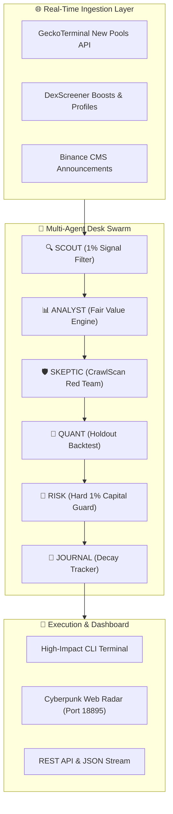

<div align="center">

# 🔱 Agentic Quant Desk
### High-Performance Multi-Agent Quantitative Risk Engine & Autonomous On-Chain Pool Hunter

[](https://github.com/thanhdatloveyou18-coder/agentic-quant-desk/stargazers)
[](https://github.com/thanhdatloveyou18-coder/agentic-quant-desk/network/members)
[](https://github.com/thanhdatloveyou18-coder/agentic-quant-desk/actions)
[](https://opensource.org/licenses/MIT)
[](https://www.python.org/downloads/)
[](https://github.com/thanhdatloveyou18-coder/agentic-quant-desk)
[](https://github.com/thanhdatloveyou18-coder/agentic-quant-desk/pulls)

<p align="center">
  <b>Built by HUYNH BUSINESS LLC &bullet; Primary Maintainer: Thao Huynh</b><br>
  <i>"Code guards capital — not conversation."</i>
</p>

---

⭐ **If you find this project useful or interesting, please give us a star on GitHub! It helps the project grow and fuels ongoing development.** ⭐

</div>

---

## 📖 Overview

**Agentic Quant Desk** is a production-ready, open-source quantitative framework designed to bridge autonomous AI agents with institutional-grade trading desk risk controls. 

Most automated bots trade blindly or rely on generic LLMs that suffer from hallucination and prompt leakage. **Agentic Quant Desk** introduces a **6-Agent Adversarial Swarm** inspired by Jane Street trading desk protocols and Stanford CS224R reinforcement learning principles, guarded by mathematical AMM liquidity fragility algorithms (**CrawlScan Engine**).

```text
===================================================================================
  [SCOUT]  --> DEX Mempool & Fresh Liquidity Pool Hunter (Solana, Base, BSC)
  [ANALYST]--> Fair Value Range & Order Book Microstructure Modeling
  [QUANT]  --> 12-Month Holdout Backtest with Walk-Forward Optimization
  [SKEPTIC]--> Adversarial CrawlScan Shock Invariant: Delta P = 1 - (R / (R + q))^2
  [RISK]   --> Code-Guarded 1.0% Max Position Risk with Hard OTO Bracket Stop-Loss
  [JOURNAL]--> SQLite Alpha Attenuation & Execution Slippage Tracking
===================================================================================
```

---

## ⚡ Key Pillars & Features

### 1. 🧮 CrawlScan Mathematical Engine
AMM pools operate under constant-product dynamics ($x \cdot y = k$). The CrawlScan engine calculates the exact non-linear price impact of a sudden dumping of $q$ tokens by Cabal wallet clusters:
$$\Delta P = 1.0 - \left(\frac{\text{Reserve}}{\text{Reserve} + q}\right)^2$$
Eliminates 99% of thin-liquidity honeypots and Sybil bundles before any capital is committed.

### 2. 🌐 Multi-Chain Real-Time Hunter
Zero-auth, non-blocking asynchronous pipeline monitoring fresh DEX pools across:
- **Solana**: Pump.fun, Raydium CPMM/AMM, Meteora DLMM
- **Base**: Aerodrome SlipStream, Uniswap V3
- **BNB Smart Chain (BSC)**: PancakeSwap V2/V3

### 3. 🛡️ Adversarial "Code-Guards-Money" Architecture
No LLM has direct execution authorization. Any signal proposed by generative agents must pass deterministic Python risk verification (`risk_check.py`), enforcing:
- Maximum 1.0% risk per trade.
- Mandatory One-Triggers-the-Other (OTO) bracket stop-losses.
- Emergency portfolio drawdown circuit breaker (`kill.py`).

---

## 📊 Comparison Matrix

| Capability | Agentic Quant Desk | Traditional Trading Bots | CCXT / Hummingbot | Generic LLM Chains |
| :--- | :---: | :---: | :---: | :---: |
| **Autonomous 6-Agent Swarm** | ✅ **Native** | ❌ (Hardcoded scripts) | ❌ (Scripted) | ⚠️ (No risk guard) |
| **CrawlScan Invariant Formula** | ✅ **$\Delta P = 1 - (R/(R+q))^2$** | ❌ | ❌ | ❌ |
| **Jane Street 1% Loss Guard** | ✅ **Code-Enforced** | ❌ | ⚠️ (Manual rules) | ❌ (Hallucination risk) |
| **Zero-Auth Multi-Chain Discovery** | ✅ **Solana / Base / BSC** | ❌ | ⚠️ (Exchange API keys) | ❌ |
| **Sub-Second Edge Vision Filter** | ✅ **Nano-Gate (cv2.absdiff)** | ❌ | ❌ | ❌ |
| **Open-Source MIT License** | ✅ **100% Free** | ⚠️ (Freemium/Paid) | ✅ | ✅ |

---

## 🏛️ System Architecture



---

## 🚀 Quick Start

### Installation

```bash
git clone https://github.com/thanhdatloveyou18-coder/agentic-quant-desk.git
cd agentic-quant-desk
pip install -e .
```

### 1. Run Interactive Desk Simulation (CLI)

```bash
python -m agentic_quant.cli --demo
```

Output:
```text
=================================================================
  AGENTIC QUANT DESK v1.0.0
  High-Performance Autonomous Multi-Agent Risk Engine
  Jane Street Quant Architecture // CrawlScan AMM Fragility
=================================================================

 [*] INITIALIZING 6-AGENT COOPERATIVE SWARM...
  [AGENT: SCOUT   ] Scanning DEX Mempools (Solana, Base, BSC) for fresh liquidity...
  [AGENT: ANALYST ] Calculating Fair Value Range & Order Book Imbalance...
  [AGENT: QUANT   ] Executing 12-Month Holdout Backtest with Strict Walk-Forward...
  [AGENT: SKEPTIC ] Injecting CrawlScan Invariant Shock: 1 - (R / (R + q))^2...
  [AGENT: RISK    ] Enforcing 1.0% Max Position Risk with Hard OTO Bracket Stop-Loss...
  [AGENT: JOURNAL ] Recording Alpha Attenuation & Slippage Signature to SQLite...
-----------------------------------------------------------------
 [OK] DESK EXECUTION PASS: OTO Bracket Stop-Loss Armed at -3.5%.
```

### 2. Scan Real-Time DEX Pools Across Multi-Chain

```bash
python -m agentic_quant.cli --scan --chains solana base bsc --min-liq 5000
```

### 3. Run On-Chain Fragility Audit in Python

```python
from agentic_quant import CrawlScanMath

# Audit a token with $50,000 reserve liquidity and $500,000 FDV
result = CrawlScanMath.analyze_token_fragility(liquidity_usd=50000, fdv=500000)

print(f"Safety Score: {result['crawlscan_score']}/100")
print(f"Projected 12% Cabal Dump Impact: -{result['drop_12pct_cabal']}%")
print(f"Verdict: {result['verdict']}")
```

---

## 🎯 Star Milestones & Roadmap

Help us reach our milestones by giving this repo a **Star** ⭐!

- [x] **v0.1**: Core CrawlScan Invariant Formula & Fragility Calculator.
- [x] **v0.2**: Zero-Auth Multi-Chain Pool Hunter (Solana, Base, BSC).
- [x] **v1.0**: Interactive Multi-Agent CLI & Automated Unit Testing Suite.
- [ ] ⭐ **100 Stars**: Pump.fun Fast-Execution Engine via Jito MEV Bundles.
- [ ] ⭐ **250 Stars**: Automated Real-Time Discord & Telegram Webhook Radar.
- [ ] ⭐ **500 Stars**: Binance & Bybit CEX Pre-Listing Arbitrage Radar.
- [ ] ⭐ **1,000 Stars**: On-Device Quantized Local LLM (Ollama) Skeptic Agent.

---

## 📈 Star History

[](https://star-history.com/#thanhdatloveyou18-coder/agentic-quant-desk&Date)

---

## 🧪 Testing & Verification

Run the comprehensive unit test suite:

```bash
python -m unittest discover tests -v
```

---

## 🤝 Contributing & Community

We welcome contributions from quantitative developers, machine learning researchers, and on-chain security auditors worldwide. 

- Found a bug? Open an [Issue](https://github.com/thanhdatloveyou18-coder/agentic-quant-desk/issues).
- Want to add a feature? Submit a [Pull Request](https://github.com/thanhdatloveyou18-coder/agentic-quant-desk/pulls).
- Please check out [CONTRIBUTING.md](CONTRIBUTING.md) before submitting code.

---

## 📜 License & Citation

Distributed under the **MIT License**. See [LICENSE](LICENSE) for more details.

```bibtex
@software{agentic_quant_desk_2026,
  author = {Huynh, Thao},
  title = {Agentic Quant Desk: Autonomous Multi-Agent Quantitative Risk Framework},
  year = {2026},
  publisher = {GitHub},
  journal = {GitHub repository},
  howpublished = {\url{https://github.com/thanhdatloveyou18-coder/agentic-quant-desk}}
}
```

<div align="center">
  <b>HUYNH BUSINESS LLC</b><br>
  4440 BRIARWOOD CT S, Annandale, VA 22003<br>
  Contact: <a href="mailto:thao@huynhbusinessllc.com">thao@huynhbusinessllc.com</a>
</div>
