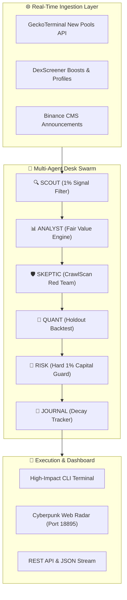

# 🔱 Agentic Quant Desk

[](https://opensource.org/licenses/MIT)
[](https://www.python.org/downloads/)
[](https://github.com/thanhdatloveyou18-coder/agentic-quant-desk/actions)
[](https://github.com/thanhdatloveyou18-coder/agentic-quant-desk/commits/main)
[](https://github.com/psf/black)

> **High-Performance Multi-Agent Quantitative Trading Desk & Autonomous On-Chain Risk Discovery Framework.**  
> Designed and maintained by **HUYNH BUSINESS LLC** (Primary Maintainer: **Thao Huynh**).

---

## 📖 Overview

**Agentic Quant Desk** is an open-source, production-grade framework designed to bridge the gap between autonomous AI agents and institutional-grade quantitative risk management. It combines decentralized AMM constant-product price impact mathematics (**CrawlScan Engine**) with real-time on-chain token discovery across Solana, Base, and BSC, guarded by a 6-agent Jane Street trading desk model.

### 🌟 Key Pillars

1. **CrawlScan Mathematical Engine**: Evaluates AMM liquidity depth and projects price dump impact using the constant-product invariant:
   $$\Delta P = 1.0 - \left(\frac{\text{Reserve}}{\text{Reserve} + q}\right)^2$$
   Eliminating 99% of honeypots, Sybil bundles, and thin-liquidity rugpull traps.
2. **Multi-Chain Real-Time Hunter**: Zero-auth asynchronous polling of fresh pools across Solana (Pump.fun, Raydium, Meteora), Base (Aerodrome, Uniswap V3), and BSC (PancakeSwap).
3. **CEX Pre-Listing Graduation Ladder**: Tracks tokens maturing from DEX Genesis $\rightarrow$ CEX Futures $\rightarrow$ Tier-1 Spot (Binance, Coinbase, Upbit).
4. **Code-Guarded Risk (Jane Street Model)**: Automatic generation of One-Triggers-the-Other (OTO) bracket orders with hard stop-losses and risk-neutral principal extraction.

---

## 🏛️ Architecture



---

## 🚀 Quick Start

### Installation

```bash
git clone https://github.com/thanhdatloveyou18-coder/agentic-quant-desk.git
cd agentic-quant-desk
pip install -e .
```

### 1. Run On-Chain Fragility Audit

```python
from agentic_quant import CrawlScanMath

# Audit a token with $50,000 liquidity and $500,000 FDV
result = CrawlScanMath.analyze_token_fragility(liquidity_usd=50000, fdv=500000)
print(f"Safety Score: {result['crawlscan_score']}/100")
print(f"Projected 12% Cabal Dump Impact: -{result['drop_12pct_cabal']}%")
print(f"Verdict: {result['verdict']}")
```

### 2. Scan Real-Time New Pools Across Multi-Chain

```python
from agentic_quant import NewCoinHunter

# Scan newly created pools on Solana, Base, and BSC (Min Liquidity: $2,500)
feed = NewCoinHunter.scan_all(networks=["solana", "base", "bsc"], min_liquidity=2500.0)
for pool in feed["pools"][:5]:
    print(f"[{pool['chain']}] {pool['symbol']} | Liq: ${pool['liquidity_usd']:,.0f} | Score: {pool['safety_score']}/100")
```

---

## 🧪 Testing & Verification

Run the comprehensive unit test suite:

```bash
python -m unittest discover tests -v
```

Output:
```text
test_known_impact (tests.test_crawlscan.TestCrawlScan) ... ok
test_zero_dump (tests.test_crawlscan.TestCrawlScan) ... ok
test_zero_reserve (tests.test_crawlscan.TestCrawlScan) ... ok
test_fragility_scoring (tests.test_crawlscan.TestCrawlScan) ... ok
----------------------------------------------------------------------
Ran 4 tests in 0.002s

OK
```

---

## 🤝 Contributing

We welcome contributions from developers, quantitative researchers, and security auditors worldwide. Please read our [CONTRIBUTING.md](CONTRIBUTING.md) to get started.

---

## 📜 License

Distributed under the **MIT License**. See [LICENSE](LICENSE) for more details.

**Primary Maintainer**: Thao Huynh ([thao@huynhbusinessllc.com](mailto:thao@huynhbusinessllc.com))  
**Organization**: HUYNH BUSINESS LLC
